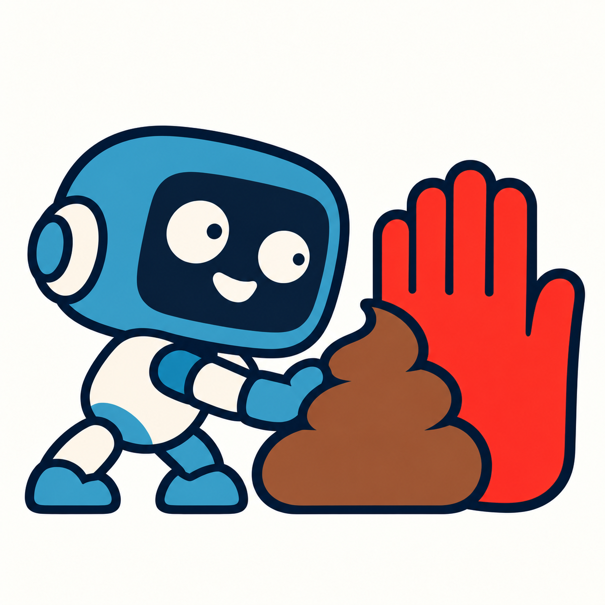
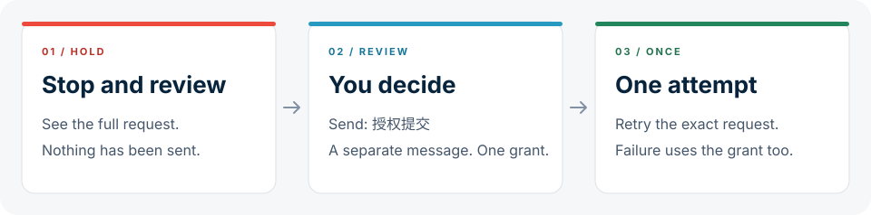

<div align="center">



<h1>STOP-PUSHING-SHIT</h1>
<p><a href="README.md">简体中文</a> · <strong>English</strong></p>
<p><strong>Write the code. Ask before pushing, creating a repository, or posting an issue or PR.</strong></p>
<p><em>Write first. Ask before you post.</em></p>
<p><sub>CODEX · v0.1.0 · MIT · LOCAL HOOKS</sub></p>
<p><a href="#how-it-works">How it works</a> · <a href="#installation">Installation</a> · <a href="#coverage-and-limits">Coverage and limits</a> · <a href="docs/README.md">Developer docs (Chinese)</a></p>

</div>

---

You're still reviewing. Your agent has already pushed the code, created a repository, or posted the issue or PR.

**STOP-PUSHING-SHIT** blocks recognized push and creation requests before they run and presents the full request for review. A separate authorization message lets that exact request run once.

The first version supports **Codex**, installed through a community marketplace. Each device needs only its platform's native executable. No Python, Go, Node, or separate service is required.

> [Source on GitHub](https://github.com/321sssrt-bit/STOP-PUSHING-SHIT) · [Release downloads](https://github.com/321sssrt-bit/STOP-PUSHING-SHIT/releases) · [MIT license](LICENSE)

## How it works



1. **Review the request.** The plugin blocks a recognized request and returns everything to review: the destination, branch, commits, and change summary for a push, or all parameters for a repository, issue, or PR.
2. **Authorize it.** Send a new message containing exactly `授权提交`. No request ID is needed. Do not add spaces, line breaks, quotes, or other text.
3. **Run it once.** Retrying the identical request is allowed once. Changed parameters or a failed attempt require a new authorization.

**The authorization phrase is currently Chinese, even when you use this English guide.** `授权提交` means "authorize submission." Copy it exactly; an English translation will not unlock the request. Plugin messages and hook labels are also currently in Chinese.

New repositories must explicitly set `private: true` or `private: false`; tool defaults are not accepted. Forks and repositories created from templates are covered too. Changes to the name, owner, visibility, or any other parameter require fresh authorization.

For pushes, use a standalone `git push <remote> <branch>`. The plugin checks the destination URL, source commit, destination branch, commit list, and file change summary. A change in commits requires fresh authorization. It supports `-C`, `-u`, `--force`, and `--force-with-lease`; explicit refspec destinations must use the full `refs/heads/...` form. Bulk pushes, tags, deletions, implicit destinations, and dynamic or compound push commands are not allowed.

"Continue," "fix it," or "submit it when you're done" do not replace this authorization. Read operations, local `git init`, cloning, editing, and preparing drafts can continue normally.

<details>
<summary><strong>A minimal example</strong></summary>

An agent is about to create a draft PR:

```text
Repository  example/project
Title       Improve installation instructions
Body        Document platform selection, installation, and single-use authorization.
Branches    docs/install -> main
Draft       true
```

The plugin first returns the full parameters and says the request has not been submitted. After reviewing it, send a separate message containing:

```text
授权提交
```

This authorizes only the request you just reviewed. The next creation request, a change in parameters, or a retry after failure needs fresh authorization.

This is an illustration, not a real GitHub operation.

</details>

## Installation

**Install from the official GitHub repository.** Run these commands in a terminal with Codex installed:

```sh
codex plugin marketplace add 321sssrt-bit/STOP-PUSHING-SHIT --ref main --sparse .agents/plugins --sparse plugins/codex
codex plugin add issue-pr-guard@stop-pushing-shit
```

This entry includes all five platform executables and selects the right one when it starts. The two `--sparse` options keep the marketplace and plugin directories, reducing unrelated source and image downloads; they do not turn the universal distribution into a single-platform download. While the repository is private, the GitHub account used for installation needs access.

Start a new chat, open `/hooks`, and review and trust the plugin's four hooks. All labels start with `禁止倒屎`, the project's Chinese name. They handle session start or resume, authorization messages, cancellation on interruption, and checks before a protected operation. All four use the same executable. **Installing the plugin is only the first step: its hooks must be enabled and trusted.**

Native Windows requires a Codex version that supports `commandWindows`.

<details>
<summary>Install a single-platform ZIP (optional)</summary>

If a [GitHub release](https://github.com/321sssrt-bit/STOP-PUSHING-SHIT/releases) includes ZIP attachments, you can download the package for your device instead. Each device needs one executable.

| Device | Platform | ZIP size | Extracted |
|---|---|---:|---:|
| Mac, Apple Silicon | `darwin-arm64` | 1.86 MB | 4.49 MB |
| Mac, Intel | `darwin-amd64` | 2.01 MB | 4.75 MB |
| Linux, ARM64 | `linux-arm64` | 1.87 MB | 4.51 MB |
| Linux, x86-64 | `linux-amd64` | 2.05 MB | 4.82 MB |
| Windows, x86-64 | `windows-amd64` | 2.15 MB | 5.07 MB |

Package names follow `STOP-PUSHING-SHIT-0.1.0-<platform>.zip`. Sizes use decimal MB and exclude Codex itself and its installation cache. Drafts, design files, and validation reports are not included in the packages.

Extract the ZIP to a directory you intend to keep. Replace `<extracted-directory>` with the directory containing `.agents/plugins/marketplace.json` and `plugin/`, then run these commands in a terminal with Codex installed:

```sh
codex plugin marketplace add '<extracted-directory>'
codex plugin add issue-pr-guard@stop-pushing-shit
```

After installation, start a new chat and review and trust the plugin in `/hooks`.

The optional `universal` ZIP contains all five platform executables for offline use: **9.89 MB** compressed and **23.45 MB** extracted. For normal installation, choose one of the platform packages above.

</details>

To disable the plugin, turn it off in plugin settings and start a new chat. To uninstall:

```sh
codex plugin remove issue-pr-guard@stop-pushing-shit
```

Local state may contain a pending submission's body. Uninstalling does not automatically delete that data.

[Full installation guide (Chinese)](plugins/codex/INSTALL.md)

## Coverage and limits

| Scenario | Version 0.1.0 behavior |
|---|---|
| Standalone, static branch `git push` with an explicit destination | Show push details, require single-use authorization, and recheck commits and parameters before retrying |
| Structured tools creating repositories, issues, or PRs, including forks, templates, and draft PRs | Show all parameters and require single-use authorization |
| Recognized gh, REST, or GraphQL creation commands | Block and require a structured creation tool instead |
| Supported Python, shell, PowerShell, and CMD wrappers | Inspect recognizable creation calls inside them |
| Read operations, local editing, and preparing drafts | No additional creation authorization |

**This is a local guardrail for covered paths, not a complete security sandbox.** Node launching gh, browser actions, the contents of scripts on disk, unknown tools, and paths where hooks are not loaded may remain outside its coverage. Dynamic commands may also be conservatively blocked.

The plugin makes no network requests and does not read credentials. Pending request parameters are stored in the local data directory supplied by the host. See the [behavior reference (Chinese)](docs/behavior.md) for binding rules, revocation conditions, and known limits.

## Validation

Version 0.1.0 has passed authorization and push tests, including single-use consumption and concurrent race checks. The latest recorded platform installation checks are:

| Platform | First installation and upgrade | Native launch | Only the selected executable fetched |
|---|---|---|---|
| macOS arm64 / Linux arm64 / Windows amd64 | Passed in isolated real Codex installations | Passed | Passed |
| macOS amd64 / Linux amd64 | Package selection and upgrades checked on macOS | Not run natively in this validation | Passed |

Platform-branch tests in the table used a local Git test repository supporting partial clones. The official `main` entry distributes all five executables, so the single-platform download results do not apply to it.

During earlier private-repository validation, a test harness simulated a separate user authorization message, then performed one real branch push, one issue creation, and one draft PR creation. Repeated requests were denied. Host tests using a deterministic mock model also passed. These results do not establish autonomous real-model behavior or GitHub connector validation. Users still need to review and trust the hooks in their everyday desktop setup.

## What's next

| Stage | Status |
|---|---|
| **Codex, first version** | 0.1.0; single-use authorization for pushes and repository, issue, and PR creation |
| **DSH, second version** | Integration directory reserved; waiting for the actual interface |

The runtime implementation is shared, with host integration files in `plugins/`. Use the GitHub marketplace command above for installation. Standalone ZIP availability depends on the attachments listed in [GitHub Releases](https://github.com/321sssrt-bit/STOP-PUSHING-SHIT/releases).

[Repository layout (Chinese)](plugins/README.md) · [Development and packaging (Chinese)](docs/go-development.md) · [Developer docs (Chinese)](docs/README.md)

This project uses the [MIT license](LICENSE). Third-party dependency licenses are listed in [THIRD_PARTY_NOTICES.txt](THIRD_PARTY_NOTICES.txt).

---

<div align="center">

<p><strong>Let the agent write it. You decide whether to send it.</strong></p>

</div>
