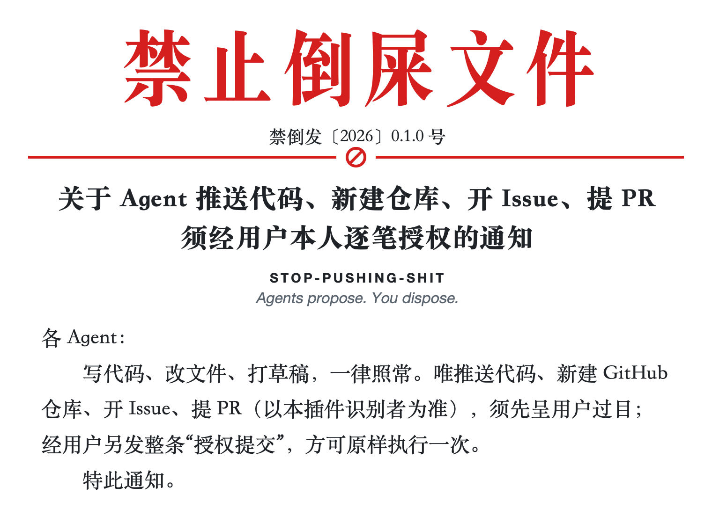
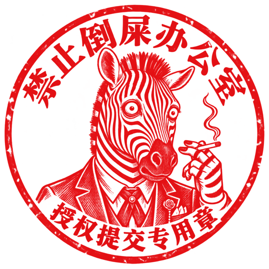

<p align="center">
  <picture>
    <source media="(prefers-color-scheme: dark)" srcset="assets/readme/header/header-dark.png">
    
  </picture>
</p>

<p align="center"><a href="README.md">简体中文</a> · <strong>English</strong></p>

<p align="center"><a href="#i-scope">Scope</a> · <a href="#ii-authorization">Authorization</a> · <a href="#iii-installation">Installation</a> · <a href="#final-provisions">Final provisions</a></p>

You're still reading the diff. The agent has already opened a PR titled "Fixed every issue."

An agent with no brakes: push the code, create a repository, file an issue, open a PR, all without looking back. When someone closes it as garbage, it's your reputation. When it's flagged as spam and the account gets restricted or banned, it's your account.

STOP-PUSHING-SHIT provides Codex and DSH plugins that hold the push, repository, issue, and PR requests they recognize at the door. They put the details in front of you first. Only after you send a separate `授权提交` message does that one request leave.

Before you authorize it, ask yourself: **Is the thing you're about to send a pile of shit?**

## I. Scope

- **Hold for authorization:** recognized `git push` requests and structured GitHub tools creating repositories (including forks and templates), issues, or PRs (including drafts).
- **Block outright:** recognized gh, REST, and GraphQL creation commands. Use a structured creation tool instead.
- **Business as usual:** local `git init`, `git clone`, read operations, and editing.

## II. Authorization

1. The agent attempts a recognized push or creation request. The plugin holds it and shows you the details. Nothing has been sent yet.
2. After reviewing it, send a separate message containing exactly `授权提交`.
3. The agent retries the identical request. It runs once.

Changed content or a failed attempt requires fresh authorization. "Continue," "fix it," and "submit it when you're done" do not count.

**The authorization phrase remains Chinese in this version.** `授权提交` means "authorize submission." Copy it exactly; its English translation will not work. Plugin messages and hook labels are also currently in Chinese.

```text
授权提交
```

<details>
<summary>The fine print</summary>

- Authorization applies only to the current pending request in the same chat, with identical parameters, once in the authorized turn. It is consumed before execution, even if the operation fails.
- The entire message must be exactly `授权提交`. Extra words, spaces, line breaks, quotes, or additional instructions do not count.
- Push details include the repository, remote URL, source commit, destination branch, commit list, and file change summary. The plugin checks whether the commits have changed before retrying.
- In Codex, use a standalone `git -C "<absolute repository path>" push <remote> <branch>`. The current Bash hook omits the tool's execution directory, so the first `-C` must name an absolute path. `-u`, `--force`, and `--force-with-lease` are supported; refspec destinations must use the full `refs/heads/...` form. Implicit destinations, bulk pushes, tags, branch deletion, and compound or dynamically constructed pushes are rejected.
- New repositories and template-based creation must explicitly provide `name` and `private` (`true` or `false`). Visibility is not guessed. If no owner is specified, the creation tool uses its currently authenticated account.
- Fork authorization binds the source `owner/repo`, target organization, and all other parameters. Visibility follows the source repository; verify it yourself, because the plugin does not query the network.

</details>

## III. Installation

Give your agent these commands:

```sh
npx --yes codex-stop-pushing-shit@0.1.1
```

Start a new chat after installation. Open `/hooks` to review and trust the plugin's hooks.

Requires Codex, Node.js 22+, and npm. No Python, Go, or separate service is required.
When switching from GitHub or ZIP, first run `codex plugin marketplace remove stop-pushing-shit`,
then immediately run the command above and review the hooks in a new chat.

**Fallbacks:** [GitHub marketplace](plugins/codex/INSTALL.md) and [GitHub Release ZIPs](https://github.com/321sssrt-bit/STOP-PUSHING-SHIT/releases/tag/codex-v0.1.1)
remain available without npm or Node.js. The release also stores the exact `.tgz` published to npm.

For disabling or uninstalling the plugin, see the [installation guide (Chinese)](plugins/codex/INSTALL.md). To uninstall directly:

```sh
codex plugin remove issue-pr-guard@stop-pushing-shit
```

Uninstalling does not automatically delete local state, which may contain a pending request's body.

**DSH users:** Install into the profile you actually use (`web` below):

```sh
dsh plugin --profile web add dsh-stop-pushing-shit@0.1.2
```

Requires DSH, Node.js 24.9+, pnpm, and Git. Supports macOS ARM64, Linux ARM64, and Windows x64.
The [DSH 0.1.2 release](https://github.com/321sssrt-bit/STOP-PUSHING-SHIT/releases/tag/dsh-v0.1.2)
retains the exact npm tarball and per-platform offline packages. See the [DSH installation guide](plugins/dsh/README.md).

## Final provisions

**Article 1.** This plugin covers only the paths it recognizes. What it cannot recognize, it cannot control. It is a local guardrail, not a security sandbox.

**Article 2.** The developer's abilities are limited. There will be gaps. Better developers are welcome to help; please review your own work before opening a PR.

**Article 3.** This notice takes effect when the hooks do. The final say belongs to you.

<br>

<p align="right">
  Office of Stop Pushing Shit<br>
  <sub>October 27, 2026</sub><br>
  
</p>

<p align="center"><sub><a href="LICENSE">MIT license</a> · <a href="docs/verification.md">Validation (Chinese)</a> · <a href="docs/README.md">Developer docs (Chinese)</a></sub></p>
