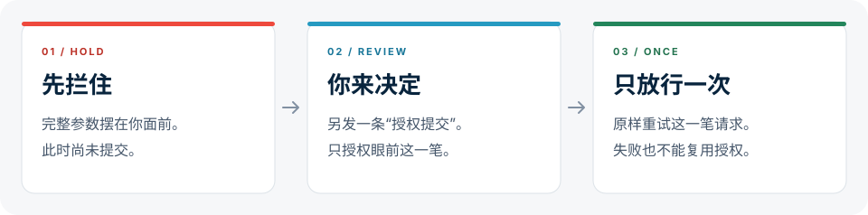

<div align="center">


<h1>STOP-PUSHING-SHIT</h1>
<p><strong>简体中文</strong> · <a href="README.en.md">English</a></p>
<p><strong>禁止倒屎 · 代码先写，推送、建仓、Issue / PR 先问。</strong></p>
<p><em>Write first. Ask before you post.</em></p>
<p><sub>CODEX · v0.1.0 · MIT · 本地 HOOK</sub></p>
<p><a href="#怎么工作">怎么工作</a> · <a href="#安装">安装</a> · <a href="#覆盖与边界">覆盖与边界</a> · <a href="docs/README.md">开发文档</a></p>

</div>

---

你还在审阅，Agent 已经推了代码、建了仓库，或把 Issue / PR 发出去了。

**STOP-PUSHING-SHIT** 在已识别的推送或创建请求执行前拦住它，把完整内容交给你审阅。你另发一条 `授权提交`，才放行这一笔。

首版面向 **Codex**，按社区 marketplace 方式安装。每台设备只需对应平台的原生程序，无需 Python、Go、Node，也不用单独启动服务。

> [GitHub 源码](https://github.com/321sssrt-bit/STOP-PUSHING-SHIT) · [Releases 下载](https://github.com/321sssrt-bit/STOP-PUSHING-SHIT/releases) · [MIT 许可证](LICENSE)

## 怎么工作



1. **先展示。** Agent 发起已识别的请求，插件先拒绝执行，返回待审阅的完整内容：推送的目标、分支、提交和改动摘要，或建仓、Issue / PR 的全部参数。
2. **你授权。** 审阅后，另发一条消息，整条准确写 `授权提交`，不用填写编号，也不能附加空格、换行或其他文字。
3. **只执行一次。** 同一笔参数原样重试，放行一次；参数改变或调用失败，都需要重新授权。

新建仓库须明确 `private: true/false`，不能依赖工具默认值。fork 与模板建仓同样受限；名称、归属、可见性或其他参数改变，都需要重新授权。

推送使用单独一条 `git push <remote> <分支>`。插件核对目标地址、来源提交、目标分支、提交列表及文件改动摘要；提交变化也要重新授权。支持 `-C`、`-u`、`--force`、`--force-with-lease`；显式 refspec 的目标须写全 `refs/heads/...`。批量、标签、删除、隐含目标、动态或组合推送暂不放行。

“继续”“修好”“最后帮我提交”不会代替这次授权。查询、本地 `git init`、clone、编辑和准备草稿可以照常进行。

<details>
<summary><strong>看一个最小例子</strong></summary>

Agent 准备创建一个 draft PR：

```text
仓库    example/project
标题    补充安装说明
正文    补充平台选择、插件安装和单次授权说明。
分支    docs/install → main
Draft   true
```

插件会先返回“尚未提交”和完整参数。审阅后，另发一条消息：

```text
授权提交
```

这只授权眼前这一笔。下一次创建、参数变化，或者本次调用失败后再试，都需要重新授权。

以上是流程示意，不是真实 GitHub 操作。

</details>

## 安装

**从正式 GitHub 仓库安装。** 在已安装 Codex 的终端运行：

```sh
codex plugin marketplace add 321sssrt-bit/STOP-PUSHING-SHIT --ref main --sparse .agents/plugins --sparse plugins/codex
codex plugin add issue-pr-guard@stop-pushing-shit
```

该入口携带五个平台程序，启动时自动选择当前设备对应的程序。两项 `--sparse` 保留 marketplace 和插件目录，减少无关源码与图片下载；它不会把通用包变成单平台下载。仓库为私有时，安装所用的 GitHub 账户须有访问权限。

开启新聊天，在 `/hooks` 中审阅并信任本插件的四项 Hook：开始或恢复聊天、接收本次授权、中断时撤销授权、提交前检查。它们都以“禁止倒屎”开头，共用一个程序。**安装成功后，还需要让 Hook 生效。**

<details>
<summary>单平台 ZIP 安装（可选）</summary>

如果 [GitHub Release](https://github.com/321sssrt-bit/STOP-PUSHING-SHIT/releases) 附带 ZIP，也可以下载设备对应的平台包。每台设备只需一份程序。

| 你的设备 | 平台 | ZIP 大小 | 解压后 |
|---|---|---:|---:|
| Mac · Apple Silicon | `darwin-arm64` | 1.86 MB | 4.49 MB |
| Mac · Intel | `darwin-amd64` | 2.01 MB | 4.75 MB |
| Linux · ARM64 | `linux-arm64` | 1.87 MB | 4.51 MB |
| Linux · x86-64 | `linux-amd64` | 2.05 MB | 4.82 MB |
| Windows · x86-64 | `windows-amd64` | 2.15 MB | 5.07 MB |

包名格式：`STOP-PUSHING-SHIT-0.1.0-<平台>.zip`。大小按十进制 MB 计，不含 Codex 自身及安装缓存；草稿、视觉制作文件和验收报告均不在包内。

解压到准备长期保留的目录，在已安装 Codex 的终端运行：

```sh
codex plugin marketplace add '<解压目录>'
codex plugin add issue-pr-guard@stop-pushing-shit
```

安装后同样需要开启新聊天，在 `/hooks` 中审阅并信任插件。

`universal` 包保留作可选离线合集，包含五个平台程序：ZIP 9.89 MB，解压后 23.45 MB；日常安装选择上表的单平台包即可。

</details>

[完整安装、停用与卸载说明 →](plugins/codex/INSTALL.md)

## 覆盖与边界

| 场景 | 首版行为 |
|---|---|
| 单独、静态、明确目标的分支 `git push` | 展示推送明细，等待单次授权；重试前核对提交与参数 |
| 结构化工具创建仓库、Issue / PR，包括 fork、模板建仓和 draft PR | 展示完整参数，等待单次授权 |
| 已识别的 gh、REST、GraphQL 创建命令 | 阻止，要求改用结构化创建工具 |
| 已覆盖的 Python、Shell、PowerShell / CMD 包装 | 检查其中可识别的创建调用 |
| 查询、本地编辑、准备草稿 | 不追加创建授权 |

**这是已覆盖路径上的本地护栏，不是完整安全沙箱。** Node 启动 gh、浏览器操作、磁盘脚本内部、未知工具和未加载 Hook 的路径仍可能不受约束。动态命令也可能被保守拒绝。

插件不联网、不读取凭证；待审阅参数保存在宿主分配的本地数据目录。完整的绑定规则、撤销条件和已知边界见 [行为说明](docs/behavior.md)。

## 验证情况

0.1.0 的授权、推送相关测试及单次消费、并发 race 检查已通过。分平台安装的最近一次验证结果如下：

| 平台 | 首次安装与升级 | 原生启动 | 只获取对应平台程序 |
|---|---|---|---|
| macOS arm64 / Linux arm64 / Windows amd64 | 真实 Codex 隔离验证通过 | 通过 | 通过 |
| macOS amd64 / Linux amd64 | 在 macOS 上完成包选择与升级检查 | 本轮未原生运行 | 通过 |

表中分平台验证使用支持按需拉取的本地 Git 测试仓库；正式 `main` 入口使用五平台通用分发，不套用分平台下载体积结论。

此前私仓安装验证中，测试程序模拟独立用户授权后，实际分支推送、Issue、draft PR 各执行一次，重复请求被拒绝。确定性假模型宿主测试也已通过；这些结果不等于真实模型自主操作或 GitHub connector 验收，日常桌面 Hook 信任流程仍需用户确认。

## 接下来

| 阶段 | 状态 |
|---|---|
| **Codex 首版** | 0.1.0；支持推送、建仓、Issue / PR 的单次授权 |
| **DSH 第二版** | 已预留接入目录，等待实际接口确认 |

运行实现保留一份，宿主入口放在 `plugins/`。正式安装使用上面的 GitHub marketplace 命令；独立 ZIP 以 [GitHub Releases](https://github.com/321sssrt-bit/STOP-PUSHING-SHIT/releases) 中列出的附件为准。

[仓库结构](plugins/README.md) · [开发与打包](docs/go-development.md) · [开发文档](docs/README.md)

项目采用 [MIT 许可证](LICENSE)；第三方依赖的许可见 [THIRD_PARTY_NOTICES.txt](THIRD_PARTY_NOTICES.txt)。

---

<div align="center">

<p><strong>让 Agent 把内容写好。发不发，你决定。</strong></p>

</div>
