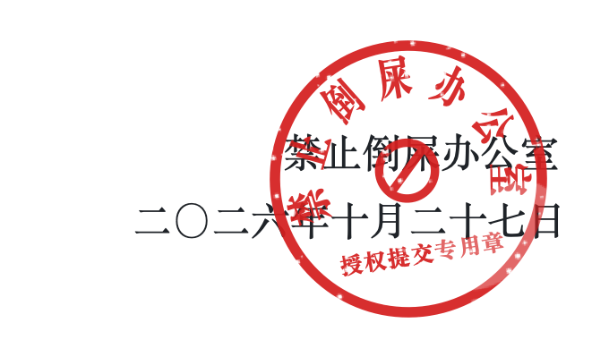

<p align="center">
  <picture>
    <source media="(prefers-color-scheme: dark)" srcset="assets/readme/cc-draft-r03/header-dark.png">
    
  </picture>
</p>

<p align="center"><a href="#一管什么">管什么</a> · <a href="#二怎么批">怎么批</a> · <a href="#三怎么装">怎么装</a> · <a href="#附则">附则</a></p>

你还在看 diff，Agent 已经把 PR 开出去了，标题叫“修好了所有问题”。

没品的 Agent 就是这样：闭着眼推代码、建仓库、报 Issue、提 PR，一气呵成，头也不回。被人当垃圾关掉，丢的是你的脸；被认定刷屏，受限甚至封号，赔的是你的账号。

禁止倒屎是一个 Codex 插件，专把它认得出的推送、建仓、Issue、PR 请求拦在门口：具体内容先摆到你面前，你另发一句“授权提交”，这一笔才出门。

发出“授权提交”之前，也问问自己：**今天交出去的，是狗屎吗？**

## 一、管什么

- **扣下等授权：** 已识别的 `git push`，以及 GitHub 新建仓库（含 fork、模板建仓）、开 Issue、提 PR（含 draft）。
- **直接挡回：** 已识别的 `gh`、REST、GraphQL 创建命令，要求改用结构化创建工具。
- **照常进行：** 本地 `git init`、`git clone`、查询、编辑。

## 二、怎么批

1. Agent 发起已识别的推送或创建请求，插件先扣下：什么都没发出去，具体内容摆到你面前。
2. 你看完，另发一条消息，整条只写 `授权提交`。
3. Agent 原样重试，这一笔执行一次。

内容改了或执行失败，都要重新授权。“继续”“修好”“最后提交”不算数。

<details>
<summary>细则</summary>

- 授权只认当前待审阅的这一笔，绑定它的全部内容，用一次即作废。
- 消息必须整条只有 `授权提交`，前后加字、引号或附加要求都不算。
- 新建和模板建仓须写明 `name` 与 `private`（`true` / `false`），不猜默认可见性；没写归属时，用创建工具当前认证的账户。
- fork 绑定源仓库 `owner/repo`、目标组织等全部参数，可见性继承源仓库；插件不联网查询，请自行核实。

</details>

## 三、怎么装

把下面的命令发给你的 Agent：

```text
INSTALL_COMMANDS_PENDING
```

装好后开一个新聊天，在 `/hooks` 里审阅并信任本插件的 Hook。

## 附则

**第一条**　本插件只覆盖它能识别的路径，识别不了的就管不到。它是一道本地护栏，不是安全沙箱。

**第二条**　开发者能力有限，漏网之鱼肯定还有。欢迎更强的开发者来一起完善；提 PR 之前，请先自己审一遍。

**第三条**　本通知自 Hook 生效之日起施行，最终解释权归你。

<br>

<p align="right">
  <picture>
    <source media="(prefers-color-scheme: dark)" srcset="assets/readme/cc-draft-r01/signoff-dark.png">
    
  </picture>
</p>
